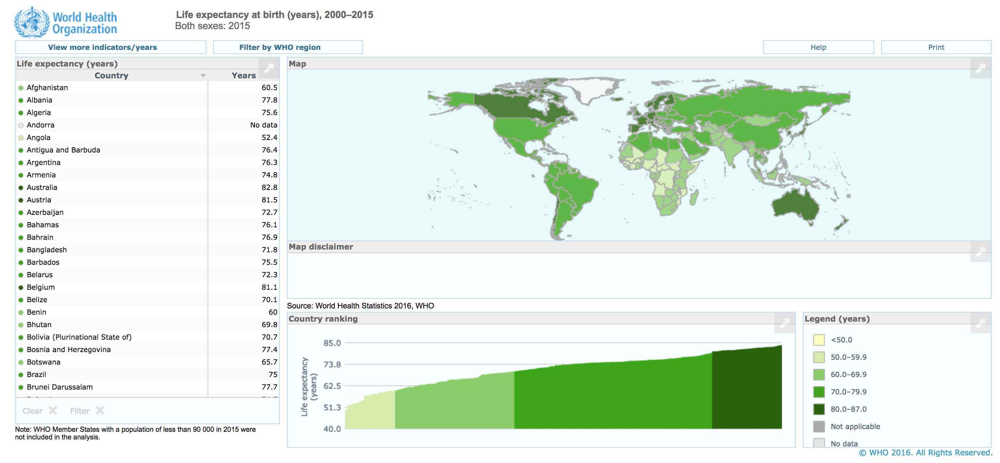
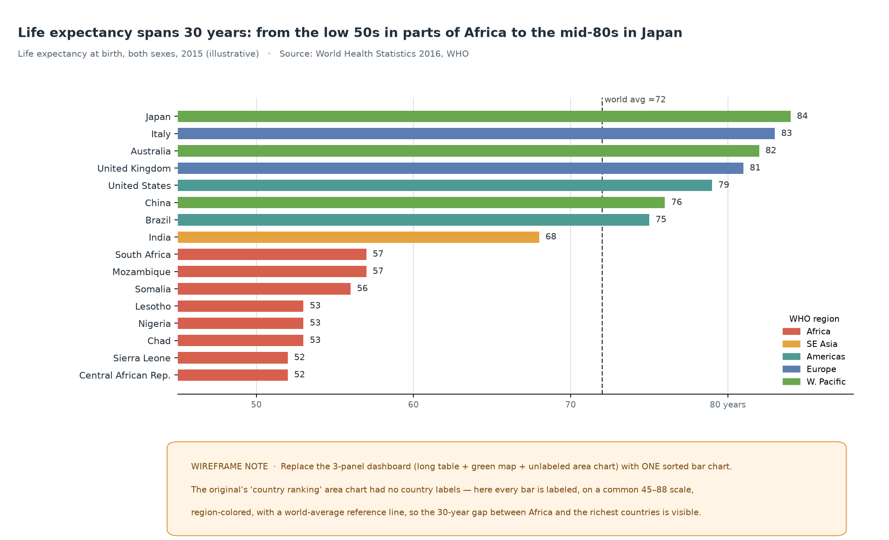
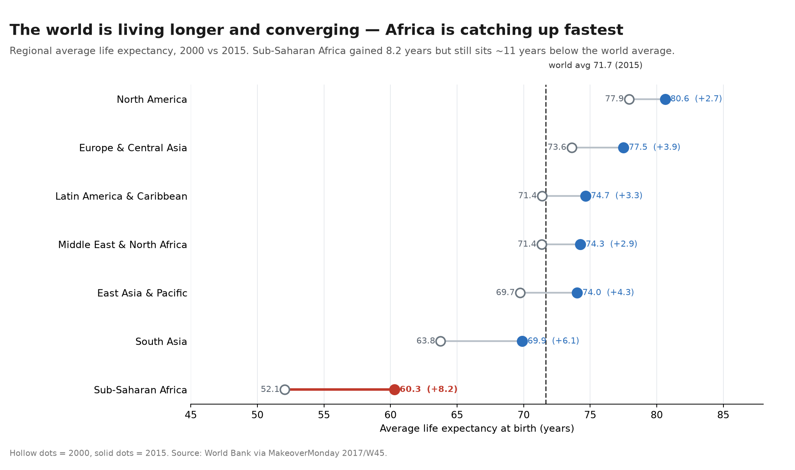
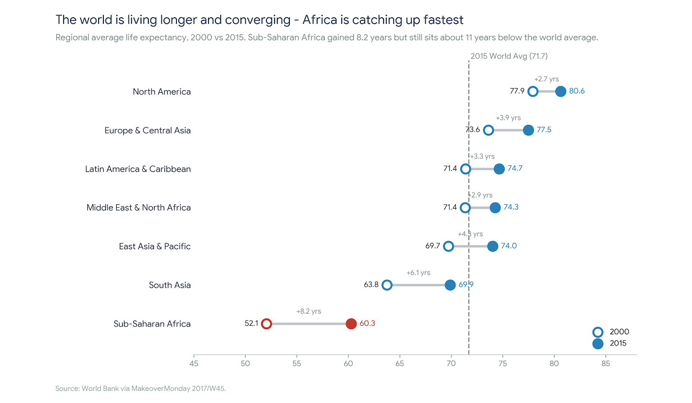

| [home page](https://cat-of-landlord.github.io/tswd-portfolio-templates/) | [ai critique](ai-critique) | [data viz examples](dataviz-examples) | [critique by design](critique-by-design) | [final project I](final-project-part-one) | [final project II](final-project-part-two) | [final project III](final-project-part-three) |

# Critique & Redesign — Global Life Expectancy (MakeoverMonday 2017/W45)

*Telling Stories with Data, Fall 2026. This page documents my full critique-by-design workflow — selecting a chart, scoring it with Stephen Few's Data Visualization Effectiveness Profile, sketching, peer testing, and rebuilding the visualization with a CMU-approved GenAI tool. The corresponding Google Form critique was submitted separately.*

---

## Step 1 — Selecting a visualization

I chose the 2017/W45 challenge, **"Life Expectancy at Birth by Country (1960–2015)."** The original graphic is a World Health Organization dashboard that packs a long alphabetical country table, a green choropleth world map, and an unlabeled "Country ranking" area chart onto one screen.

I picked it for three reasons. First, it is created by a professional intergovernmental source (WHO / World Bank), so it carries real authority and is worth taking seriously rather than dismissing. Second, it is a genuine example of a high-quality data source let down by its presentation — the underlying data are excellent, but the dashboard makes its own headline finding hard to see. Third, the data are fully downloadable (an Excel file covering 1960–2015), which means I can recreate the visualization accurately rather than approximating it.

---

## Step 2 — Critique with Stephen Few's Data Visualization Effectiveness Profile

I scored the original on Few's seven dimensions, each on a 0–10 scale.

| Dimension | Score | Main reasoning |
|---|---|---|
| **Usefulness** | 5 | A specialist can look up a country, but the dashboard never surfaces the single most useful fact — how unequal life expectancy is. |
| **Completeness** | 6 | It covers ~190 countries and includes a map, table, and ranking, but the ranking has no country labels and exact values require hovering. |
| **Perceptibility** | 3 | The weakest dimension. There is no common scale for the map/area panels, near-identical greens are hard to distinguish, and the ranking labels no countries. |
| **Truthfulness** | 8 | The data are WHO-verified and the encodings do not distort them; the graphic simply fails to make them legible. |
| **Intuitiveness** | 5 | The three panels require effort to connect; a casual reader cannot explain the ranking panel at a glance. |
| **Aesthetics** | 6 | Clean and professional, but the muted green palette and dense table feel flat and monotonous. |
| **Engagement** | 4 | It presents data rather than telling a story; there is little to draw a reader in or reward a second look. |

**What the critique told me.** The informative scores are dragged down mainly by *Perceptibility* (3): the original splits one message across three views that share no common scale and hides the ranking's country names. The emotive scores are similarly low because the dashboard never states a finding. The redesign should therefore do the opposite — one graphic, one common scale, every item labeled, and a title that states the point.

**How the method compares to Good Charts.** Few's profile is precise and gives a repeatable vocabulary for *why* a chart fails, especially the informative/emotive split. Good Charts is less quantitative but stronger on the front end — it pushes you to decide the message and the chart *type* before you refine anything. I found them complementary: the two-questions/four-types framework in Good Charts guided the choice of chart, while Few's profile supplied the diagnostic detail. If anything, Few underweights the early "what is the message?" question, which Good Charts handles directly.

---

## Step 3 — Sketching a solution

I translated the critique into a digital wireframe: a single **sorted horizontal bar chart** that replaces all three dashboard panels.

The wireframe encodes life expectancy by **length on a common axis** rather than by color on a map, following Few's principle that people judge position and length far more accurately than color area. It is sorted so the ranking is explicit, colored by region to preserve the geographic story without a second panel, and anchored by a dashed world-average reference line. Every bar is labeled, so the chart works as a static image.

---

## Step 4 — Testing the solution

I presented the wireframe to peers without explaining it first, following the instructor's guidance to capture unfiltered reactions. Feedback is anonymized as instructed.

- **Reviewer A — student, MSPPM program, mid-20s.** Confirmed that merging the several small graphs into one bar chart made cross-country comparison much clearer and faster; they could read the ranking immediately without a walkthrough.
- **Reviewer B — student, with prior professional analytics experience.** Argued the original map is not necessary: the regional grouping is fully conveyed by the color coding on the bars, so keeping a map would only re-add clutter.
- **Reviewer C — student, data-visualization course.** Raised a completeness concern: because the wireframe used a representative subset, I should verify that no country with an extremely high or low life expectancy had been accidentally dropped.

**Patterns and what I learned.** Two reviewers independently endorsed the simplification — one chart beats three panels — and the map was judged redundant rather than essential. The most valuable challenge was the completeness warning: a curated subset, however representative, risks omitting an extreme and quietly misrepresenting the gap. That warning is what sent me back to the full dataset to analyze the pattern before deciding what to plot.

---

## Step 5 — Building the final solution

### Finding the story before selecting data

Rather than immediately plotting all 198 countries, I went back to the full dataset to ask what pattern was actually worth showing (the "put aside the data and decide what I am trying to say" step in Good Charts). Two findings stood out.

First, the country-level gap is **closing, not static**. It fell from 42.4 years in 2000 to 35.4 in 2015, and the regional averages show clear convergence:

| Region | Mean 2000 | Mean 2015 | Gain |
|---|---|---|---|
| Sub-Saharan Africa | 52.1 | 60.3 | **+8.2** |
| South Asia | 63.8 | 69.9 | +6.1 |
| East Asia & Pacific | 69.7 | 74.0 | +4.3 |
| Europe & Central Asia | 73.6 | 77.5 | +3.9 |
| Latin America & Caribbean | 71.4 | 74.7 | +3.3 |
| Middle East & North Africa | 71.4 | 74.3 | +2.9 |
| North America | 77.9 | 80.6 | +2.7 |

The regions that started lowest gained the most — Sub-Saharan Africa more than any other. Second, that average hides real variation: Ethiopia gained 12.6 years while Swaziland gained only 0.2, so the catch-up is uneven. Even after its gains, Sub-Saharan Africa still sits about 11 years below the 2015 world average of 71.7.

This gave me a sharper message than a static "35-year gap" ranking: **the world is living longer and converging, but the disadvantage remains concentrated in one region.** It also resolved the peer completeness concern without drawing 198 bars — aggregating every country into seven honest regional averages means nothing is silently dropped, while only seven rows compete for attention.

### Design changes I carried into the build

1. **Switch from a country bar chart to a regional dumbbell chart** (2000 vs 2015), so the chart shows change and convergence rather than a single-year ranking.
2. **Use all seven regional averages**, computed from every country — no extreme is omitted, and the selection is defensible rather than arbitrary.
3. **Highlight Sub-Saharan Africa** with a distinct accent and keep the other regions muted, and add the **world-average (71.7) reference line** to show the remaining disadvantage.
4. **Label the 2000 and 2015 values and the gain** for each region, add a 2000/2015 legend, and use a colorblind-friendly palette that remains legible in grayscale.

### Generating the chart with Gemini

I built the final visualization with a **CMU-approved GenAI tool, Google Gemini** (provided free through CMU), uploading the original Excel file and prompting it to generate the chart from the data. The exact prompts are in [genai_prompts](genai_prompts), and the full conversation, including the errors and retries, is in [ai_chat_transcript](ai_chat_transcript). The final successful chat is at https://share.gemini.google/LbpxeNg6nYbl (an earlier build chat is at https://share.gemini.google/AsqR7hYySgmQ). A design target I produced during planning is shown below; the submitted image is the tool's output.

The final chart compares regional average life expectancy in 2000 (hollow dots) and 2015 (solid dots), connected so the connector length shows the gain. Every region moved right, and the longest connector is the highlighted Sub-Saharan Africa line — the visual proof of convergence. The dashed 71.7 reference line shows that despite its 8.2-year gain, Sub-Saharan Africa still ends below the world average, while the other six regions cluster above it.

---

## References

- MakeoverMonday 2017/W45 dataset: https://makeovermonday.vercel.app/dataset/life-expectancy-at-birth-by-country
- Few, S. *Data Visualization Effectiveness Profile.* Perceptual Edge.
- Berinato, S. *Good Charts* (Chapters 3–4). Harvard Business Review Press.
- Peck, E. *Data is Personal: What We Learned from 42 Interviews in Rural America.* Multiple Views.
- Source data: [Life Expectancy at Birth.xlsx](Life%20Expectancy%20at%20Birth.xlsx), World Bank / World Health Statistics, via MakeoverMonday.

## AI acknowledgements

- **Final build:** Google Gemini, a CMU-approved tool, generated the final chart from the uploaded `Life Expectancy at Birth.xlsx` using the prompts in `genai_prompts`. I directed every design decision (chart type, regional aggregation, sorting, highlight, reference line, annotations) and asked the tool to recompute and report the values so I could verify the output against the source file.
- **Process support:** I also used AI assistants to help brainstorm and structure the critique, sketch, and pattern analysis; all design choices were my own, and every factual claim and plotted value was checked against the original data. No values were invented.
- **Human work:** topic selection, the Few scoring and reasoning, the peer testing, the interpretation of feedback, the data analysis and choice of story, and the final verification were done by me.
