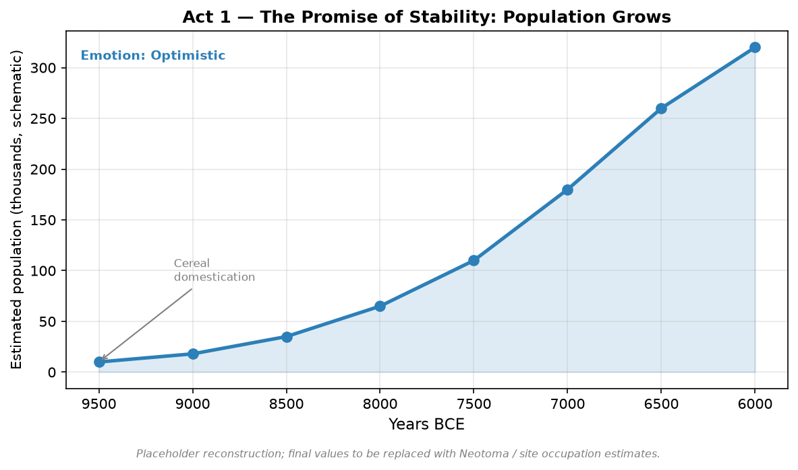
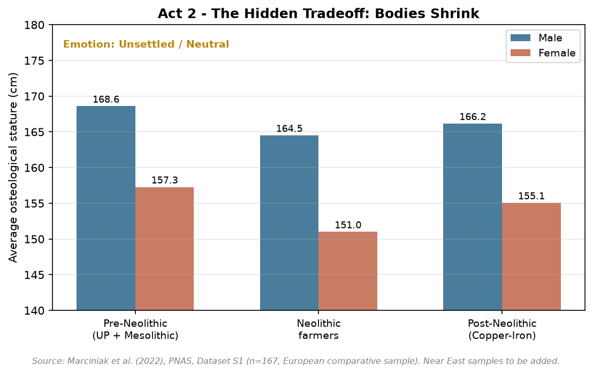
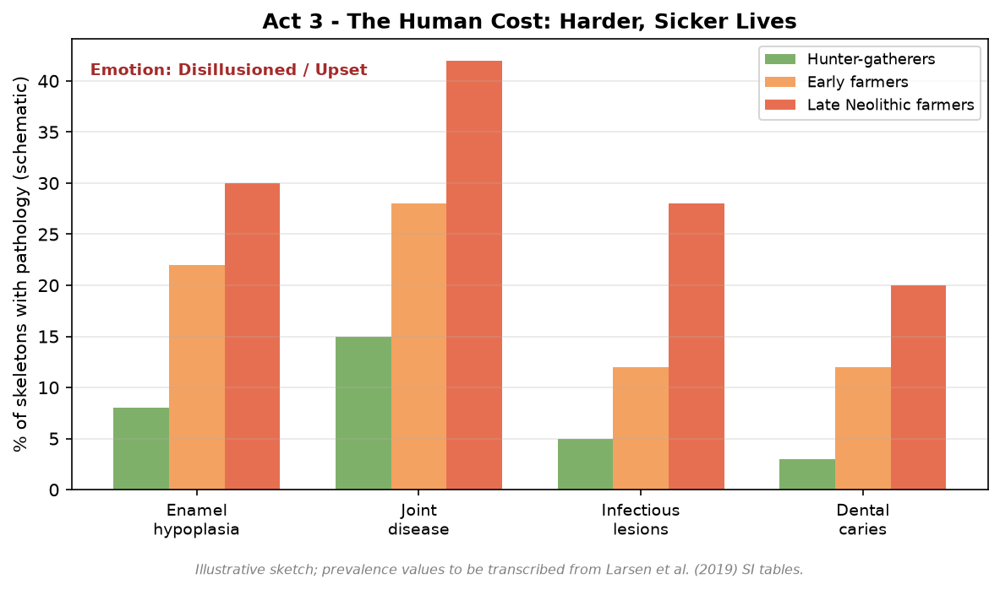

| [home page](https://cat-of-landlord.github.io/tswd-portfolio-templates/) | [ai critique](ai-critique) | [data viz examples](dataviz-examples) | [critique by design](critique-by-design) | [final project I](final-project-part-one) | [final project II](final-project-part-two) | [final project III](final-project-part-three) |

# What Did Agriculture Cost? Growth and Well-Being in the Early Neolithic Near East

*Telling Stories with Data, Fall 2026. Part I proposal: project outline, initial sketches, identified data sources, and planned method and medium.*

---

## Outline

### High-level summary

Standard histories treat the shift from hunting and gathering to settled farming as humanity's decisive leap forward: reliable food, permanent villages, population growth, and eventually cities and civilization. Popular science writing such as *Sapiens* has argued the opposite — that agriculture trapped ordinary people in worse diets, harder labor, and more disease — but this claim usually travels as anecdote, detached from the underlying skeletal evidence.

This project builds a short data story around the bioarchaeological record of the early Neolithic Near East. Using published skeletal measurements and pathology frequencies, the project compares two dimensions that move in opposite directions: collective scale (population, settlement size) and individual bodily well-being (stature, oral health, nonspecific stress markers, workload-related joint damage). The center of the story is Çatalhöyük, a large Anatolian farming settlement excavated over 25 years, whose human remains were studied in detail by Larsen et al. (2019); comparative stature data come from a published individual-level skeletal and ancient-DNA dataset (Marciniak et al., 2022). The audience is educated general readers in a public-policy classroom with no archaeology background. The goal is not to condemn farming, but to let readers inspect the evidence and see how a society can grow in size while its members' health deteriorates — and to carry that question into modern debates about what social progress should be measured by.

The analysis is bounded geographically to the Near East / Anatolia, c. 8500–6000 BCE, anchored on the Çatalhöyük settlement sequence, with a small comparative sample of pre-Neolithic foragers and Neolithic farmers. Health trends are presented with their regional and chronological context; the project does not claim that agriculture produced a uniform health collapse everywhere.

### One-sentence summary

Across early farming communities of the Near East (c. 8500–6000 BCE), archaeological skeletons show population and settlement growing while average stature, oral health, and workload indicators worsened — a paradox of collective expansion achieved at the cost of individual well-being, which invites readers to reconsider what "progress" should measure.

### User story

> As a reader, I want to see how population growth and individual health indicators moved in opposite directions during the shift to farming, so that I can examine how we measure societal progress instead of assuming that growth equals well-being.

### Audience and goal

- **Who:** CMU public-policy classmates and instructors; general readers with no background in archaeology or anthropology.
- **What they should take away:** a concrete, evidence-based sense that "more people / more food" does not automatically mean "better lives," and a vocabulary for questioning which metrics a society is judged by.
- **What the project asks of readers:** to follow one comparison through three acts and reach the closing question themselves, rather than being handed a conclusion.

### Project structure and story arc

The narrative follows the three-act structure discussed in *Good Charts* Chapter 8. The emotional arc starts where the reader's intuition already sits, introduces cracks in that intuition, and ends in reflective reconsideration.

| Act | Reader emotion | Narrative beat | Evidence carried |
|---|---|---|---|
| 1. The Promise of Stability | Optimistic | Farming ended food uncertainty; stored grain, permanent villages, rising survival and population. This matches what readers already believe. | Settlement map; population growth timeline |
| 2. The Hidden Tradeoff | Unsettled / Neutral | Food security was not nutritional quality. Diet narrowed to staple carbohydrates; bodies show stunted growth and childhood stress markers. Population rises while stature falls. | Dietary breadth comparison; stature by period and sex |
| 3. The Human Cost | Disillusioned | Farming meant longer repetitive labor, crowded settlements, new infections and parasites; joint disease, lesions, and dental caries rise through the occupation sequence. | Pathology prevalence comparison; workload indicators |
| Resolution | Reflective | The project does not reject agriculture. It asks: if a society is judged only by size and output, Neolithic farming looks like a triumph; judged by individual health and burden, it looks very different. The same measurement choice shapes policy today. | Contrast summary (growth line vs. health indicators on one timeline) |

**Act 1 — The Promise of Stability (Optimistic).** Before farming, human groups lived with seasonal scarcity and no buffer against failed hunts or bad years. In the Fertile Crescent, the domestication of wheat and barley, followed by sheep and goat, allowed stored surpluses, fixed settlements, and higher fertility. The story opens by affirming the familiar "agriculture as progress" view: more food security, more people, permanent homes.

**Act 2 — The Hidden Tradeoff (Unsettled, Neutral).** Caloric reliability did not translate into nutritional quality. Diets contracted from a broad mix of wild plants and game toward a narrow grain-heavy staple. Skeletons preserve the outcome: lower adult stature (a signal of childhood growth disruption), enamel hypoplasias from episodes of stress, and worsening oral health. Population climbs while stature drops on the same timeline — the first clear crack in the progress story.

**Act 3 — The Human Cost (Disillusioned).** The costs deepen beyond nutrition. Agriculture demanded longer, repetitive, physically heavy labor; sedentary crowding and proximity to animals promoted infectious and parasitic disease; cranial trauma rises as settlements densified (Larsen et al., 2019). Through the late occupation phases at Çatalhöyük, the skeletal record shows more joint degeneration, more lesions, more caries, than the forager comparison group. The reader arrives at the paradox: a larger, denser, more "successful" society was harder and sicker to live inside.

**Resolution — What Should We Count?** This is not an indictment of farming; it is a question about metrics. The same tension — aggregate growth alongside uneven individual outcomes — appears in modern debates over GDP, productivity, and well-being. The story leaves readers with that question rather than a moral.

**Resounding message:** A society can grow in numbers while its people get worse off; the metrics we choose decide which story we tell about progress.

### Possible closing parallel: today's productivity transitions

The resolution may draw a short, clearly separated parallel between the Neolithic transition and contemporary productivity or technology shifts. Both are transitions in which a new productive technology is framed as inevitable progress, aggregate efficiency and output rise, and costs and benefits are distributed unevenly across the population. The parallel is used only as a reflective prompt — an old pattern worth asking about — not as a claim that any modern transition is equivalent to the Neolithic one.

This closing treatment stays at the level of a neutral measurement question: how are costs and benefits distributed, and what metrics are used to judge the transition? It does not name specific companies, take a side in regulatory debates, or advocate a particular policy position. Any conceptual visual at the close will avoid brand logos and identifiable corporate referents, and the prehistoric evidence remains the main body of the story.

### In-class presentation: one minute

The live pitch is one minute long, so it carries only the core paradox and one lead comparison; the fuller evidence lives in the published web story.

| Time | Beat | On screen | Spoken line (planned) |
|---|---|---|---|
| 0:00–0:10 | Hook + question | Title card with map of the Near East | "Ten thousand years ago, humans invented farming. We call that progress — but what did it cost the people living through it?" |
| 0:10–0:25 | Act 1: growth | Population/settlement growth sketch | "Farming brought stored grain and permanent villages. Population grew fast, and settlements spread across the Fertile Crescent." |
| 0:25–0:45 | Act 2–3: the cost | Lead comparison chart: stature / pathology by group | "But the bones tell another side: people got shorter, teeth worsened, joints wore out earlier, and disease rose as settlements crowded together." |
| 0:45–1:00 | Takeaway | Resounding message on screen | "Collective size grew while individual health declined. That's an old story — and it makes you ask what we count as progress today." |

One lead Tableau visualization stays on screen for the pitch; no slide deck is used.

### Full web story: evidence strands

The published web story can carry more than the one-minute pitch. The strands below are being collected for Part II; the final narrative keeps only what serves the three-act arc.

1. **Site context.** Çatalhöyük chronology, occupation phases, estimated settlement size and location; daily life (houses, storage, diet).
2. **Collective scale.** Regional and site-level population and occupation estimates; number and size of contemporary Near Eastern sites.
3. **Stature and growth stress.** Individual-level stature by period and sex; enamel hypoplasia prevalence; biological context for these indicators.
4. **Oral and infectious health.** Dental caries, periodontal disease, periosteal lesions, anemia indicators where available.
5. **Workload and mobility.** Joint degeneration, spinal compression, limb-bone rigidity indicators of repetitive labor and herding.
6. **Dietary breadth.** Wild vs. domestic animal remains (faunal NISP) and plant remains, showing the narrowing diet.
7. **Modern bridge (closing only).** The short productivity-transition parallel described above, kept brief so the archaeological evidence stays the main event.

---

## Initial sketches

Sketches below are layout and encoding drafts that follow the outline's act structure and resounding message. Final versions will be rebuilt in Tableau.

### Sketch 1 — Act 1: Population growth and settlement spread

**Format:** dual panel — line chart (left) + time-slice map (right).
**Encoding:** line = estimated regional population over time; map = settlement sites appearing across the Near East, color intensity = site size estimate.
**Story role:** establishes the "success" story before the turn.



*Placeholder reconstruction; final population values will use Neotoma and site occupation estimates, and the map will plot excavated Neolithic site locations.*

### Sketch 2 — Act 2: Stature decline across the transition

**Format:** grouped bar chart, males and females side by side, three period groups.
**Encoding:** bar height = average osteological stature; color = sex; period on the x-axis.
**Story role:** the first quantitative crack in the progress narrative — bodies shrink while population grows.



*Source values shown: Marciniak et al. (2022), PNAS, Dataset S1 (n = 167, European comparative sample). Near Eastern samples from Rosenstock et al. (2019) will be added, and the comparative scope will be labeled clearly in the final chart.*

### Sketch 3 — Act 3: Health and workload burden

**Format:** grouped bars by pathology category, three population groups (foragers, early farmers, late farmers).
**Encoding:** bar height = share of skeletons with the pathology; color = population group.
**Story role:** delivers the Act 3 weight — concrete, bodily evidence of harder, sicker lives.



*Illustrative sketch; prevalence values will be transcribed from Larsen et al. (2019) SI tables and comparative published meta-studies. Categories shown: enamel hypoplasia, degenerative joint disease, infectious lesions, dental caries.*

### Sketch 4 — Closing paradox view (to build in Tableau)

**Format:** dual-axis timeline. Left axis = population/settlement scale (rising); right axis = health indicators (stature, pathology prevalence) moving the opposite way, aligned to the same chronological axis.
**Encoding:** one rising line for collective scale; health lines overlaid; act markers along the timeline.
**Story role:** the single image that carries the resounding message for the one-minute pitch.

### Storyboard flow

```
[Title: What did agriculture cost?]
   → Act 1 context map + population line ............ emotion: optimistic
   → Act 2 diet narrowing + stature bars ........... emotion: unsettled
   → Act 3 pathology + workload bars ................ emotion: disillusioned
   → Closing dual-axis paradox + question ........... emotion: reflective
```

---

## The data

### Primary datasets and planned use

1. **Marciniak, S. et al. (2022).** "An integrative skeletal and paleogenomic analysis of stature variation suggests relatively reduced health for early European farmers." *PNAS.* Dataset S1 (XLSX) is publicly downloadable from the Supporting Information section. It contains individual-level records: archaeological period, sex, radiocarbon/context date, geographic coordinates, osteological stature estimate, and enamel hypoplasia presence/absence (n = 167 individuals). It forms the backbone of the Act 2 stature comparison and the stress-marker layer, and supplies the published period means shown in Sketch 2 (pre-Neolithic F 157.3 / M 168.6 cm; Neolithic F 151.0 / M 164.5 cm; post-Neolithic F 155.1 / M 166.2 cm). Genotype data are archived at Dryad; analysis scripts are public on GitHub.

2. **Larsen, C. S. et al. (2019).** "Bioarchaeology of Neolithic Çatalhöyük reveals fundamental transitions in health, mobility, and lifestyle in early farmers." *PNAS* 116(25), 12615–12623. Prevalence data are reported in the article text and SI Appendix tables (dental caries, enamel hypoplasia, periosteal reactions, joint disease, cranial trauma). This source carries the Act 3 site-level evidence — pathology and workload trends across the 7100–5950 cal BCE occupation sequence, including cranial trauma counts (25 of 93 analyzed crania with healed depressed fractures). Prevalence frequencies will be transcribed from the published tables into a cleaned CSV archived in the repository, with original table locations and page numbers recorded alongside the transcription.

3. **Open Context: Çatalhöyük Zooarchaeology** (2013 release). Public, DOI-assigned archaeological dataset with faunal remains (NISP, herd structure) downloadable in tabular form; supporting projects cover Area TP and comparative Anatolian sites. Used for the Act 2 dietary breadth comparison (wild game vs. domestic sheep/goat/cattle), showing the narrowing food base.

4. **Rosenstock, E. et al. (2019).** "Human stature in the Near East and Europe ca. 10,000–1000 BC: its spatiotemporal development in a Bayesian errors-in-variables model." *Archaeological and Anthropological Sciences* 11(10), 5657–5690 (open access). Pooled reanalysis of 6,000+ prehistoric skeletons with stature estimates; supplementary material available with the open-access article. Used for Near Eastern stature trend context and to represent regional variability in the transition's effects.

5. **Neotoma Paleoecology Database.** Public archaeological/paleoenvironmental records with site chronology and occupation estimates. Used for site dates, occupation phases, and regional settlement context for the Act 1 map and timeline.

### Source links

| Name | URL | Description |
|------|-----|-------------|
| Marciniak et al. (2022), PNAS — Dataset S1 | https://www.pnas.org/doi/10.1073/pnas.2106743119 | Individual-level stature, sex, period, dates, coordinates, enamel hypoplasia (n = 167) |
| Larsen et al. (2019), PNAS — Çatalhöyük bioarchaeology | https://www.pnas.org/doi/10.1073/pnas.1904345116 | Site-level pathology, workload, and trauma prevalence tables across the occupation sequence |
| Open Context — Çatalhöyük Zooarchaeology | https://opencontext.org/projects/1b426f7c-99ec-4322-4069-e8dbd927ccf1 | Faunal remains (NISP, herd structure) for the dietary breadth comparison |
| Rosenstock et al. (2019), Archaeological and Anthropological Sciences | https://doi.org/10.1007/s12520-019-00850-3 | Pooled Near East/Europe stature meta-analysis with regional context |
| Neotoma Paleoecology Database | https://www.neotomadb.org | Site chronology, occupation phases, and regional settlement records |

### Data handling and citation notes

Downloaded copies of each dataset (or cleaned transcriptions of table values) will be archived in the repository `data/` folder, with a README recording source, access date, license/terms, and any transformations applied. Comparative groups are defined explicitly: late Epipaleolithic / Pre-Neolithic foragers vs. Early/Middle Neolithic settled farmers; at Çatalhöyük, early vs. late occupation phases are compared within the site sequence. Every statistic shown in the final story traces to one of the sources above; figures from secondary summaries such as blogs or encyclopedias are not used as evidence. Source images in the final web piece will be self-generated charts, openly licensed, or reproduced with documented permission, with credits on the image.

Ideas originating in the scholarly sources below (and in Cohen & Armelagos, 1984; Larsen, 2006; and Harari, 2011 as a popularizer) are attributed in text rather than presented as original insight. Paraphrase is genuine rewriting; any direct quotation uses quotation marks plus page number and is used sparingly. Each statistic names its source in the sentence or chart annotation, with a full reference in the list below (Chicago author-date, managed in Zotero).

---

## Method and medium

The final project will be an interactive, standalone web story: a Shorthand scrolling narrative embedding Tableau Public visualizations, published from the course portfolio repository. PowerPoint and Excel are not used as the deliverable. The scroll-based structure matches the three-act emotional arc: readers move from the optimistic opening to the closing reflection as charts appear in sequence, and Tableau Public embeds preserve interactivity such as hover tooltips and period/group toggles without requiring downloads.

Alternatives considered were ArcGIS Story Maps (strong spatial storytelling, but this story is driven mainly by temporal and group comparison, with maps as a supporting element), a hand-built GitHub Pages HTML site (full control, but higher development cost and less narrative tooling than Shorthand), and a recorded slide video (which would lose the interactive charts and scroll narrative). Part II will assemble the cleaned data, build the Tableau views, and write the full Shorthand narrative.

---

## References

- Cohen, M. N., & Armelagos, G. J. (Eds.). (1984). *Paleopathology at the Origins of Agriculture*. Academic Press.
- Harari, Y. N. (2011). *Sapiens: A Brief History of Humankind*. Harvill Secker.
- Larsen, C. S. (2006). "The agricultural revolution as environmental catastrophe: Implications for health and lifestyle in the Holocene." *Quaternary International* 150(1), 12–20.
- Larsen, C. S., et al. (2019). "Bioarchaeology of Neolithic Çatalhöyük reveals fundamental transitions in health, mobility, and lifestyle in early farmers." *PNAS* 116(25), 12615–12623. https://www.pnas.org/doi/10.1073/pnas.1904345116
- Marciniak, S., et al. (2022). "An integrative skeletal and paleogenomic analysis of stature variation suggests relatively reduced health for early European farmers." *PNAS*. https://www.pnas.org/doi/10.1073/pnas.2106743119
- Open Context. (2013). *Çatalhöyük Zooarchaeology*. https://opencontext.org/projects/1b426f7c-99ec-4322-4069-e8dbd927ccf1
- Rosenstock, E., Ebert, J., Martin, R., Hicketier, A., Walter, P., & Groß, M. (2019). "Human stature in the Near East and Europe ca. 10,000–1000 BC." *Archaeological and Anthropological Sciences* 11(10), 5657–5690. https://doi.org/10.1007/s12520-019-00850-3

## AI acknowledgements

- **Process support:** An AI assistant helped brainstorm the topic framing, structure the three-act outline, and draft the proposal prose; the topic selection, story arc, audience definition, source selection, and all interpretive choices were my own.
- **Sketch generation:** The three placeholder charts were generated with Python/matplotlib from published source values where available; schematic values are labeled on the figures and will be replaced with cleaned dataset values in Part II.
- **Verification:** Every cited source link and published statistic was checked against the referenced publication; no source attribution or figure is invented. Final data cleaning, Tableau builds, and narrative writing remain my own work.
