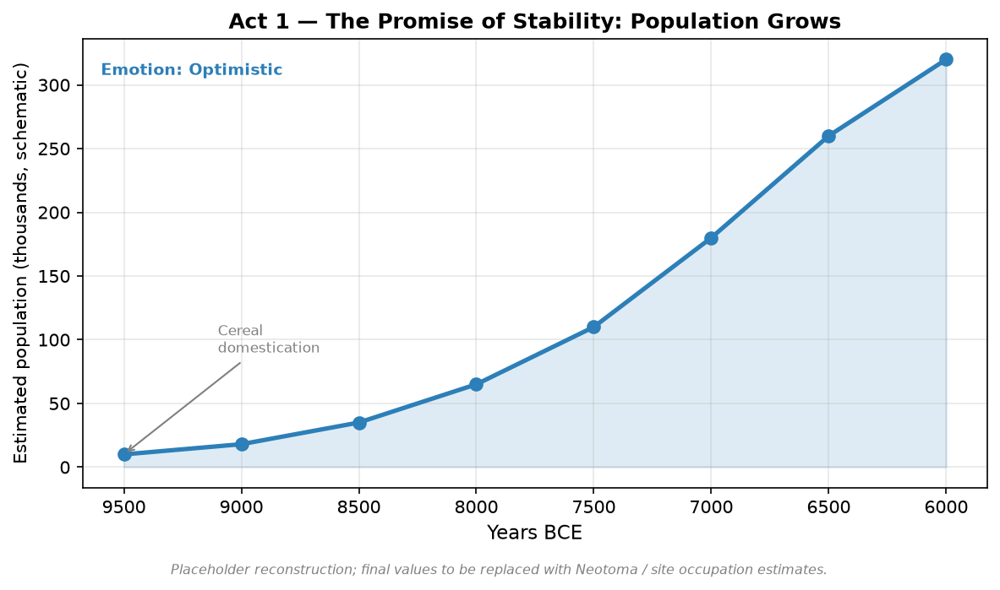
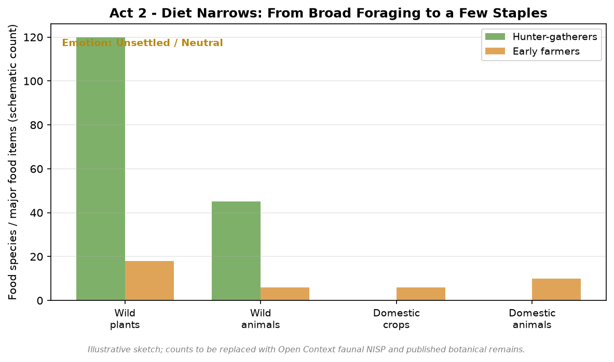
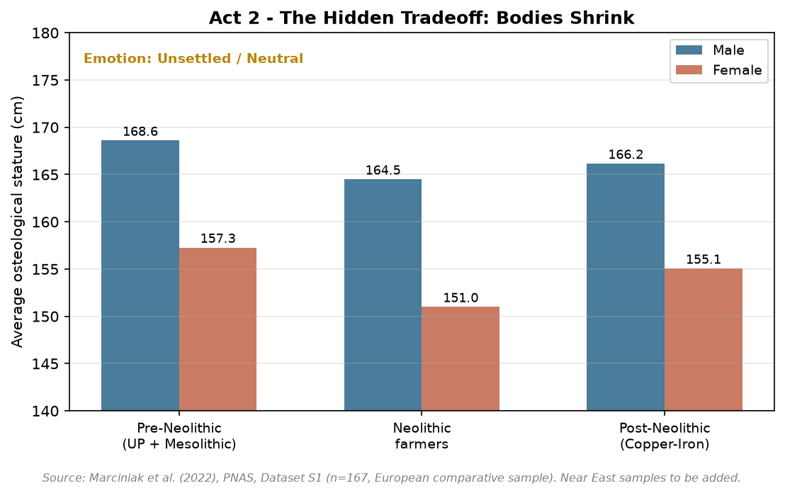
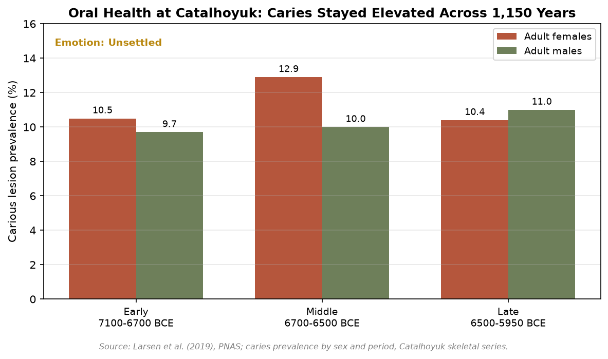
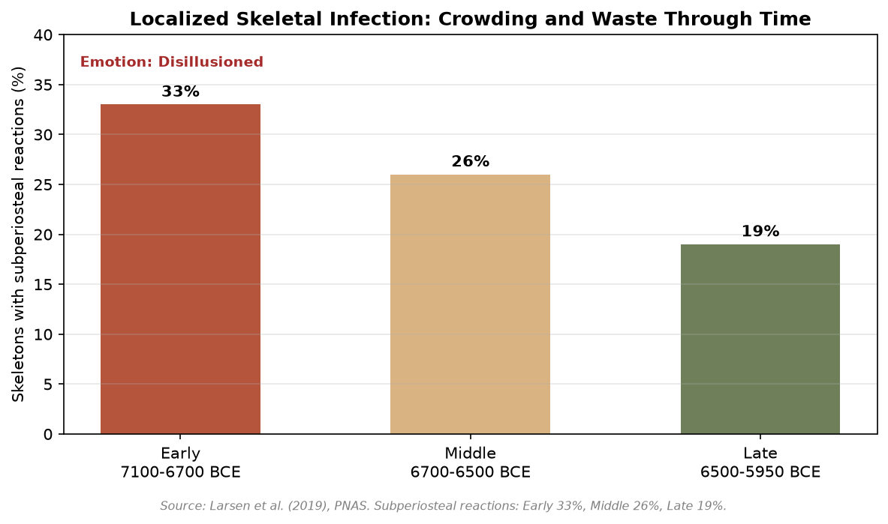
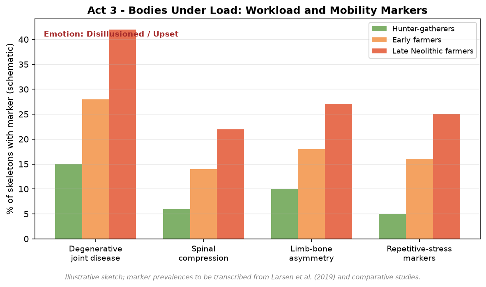
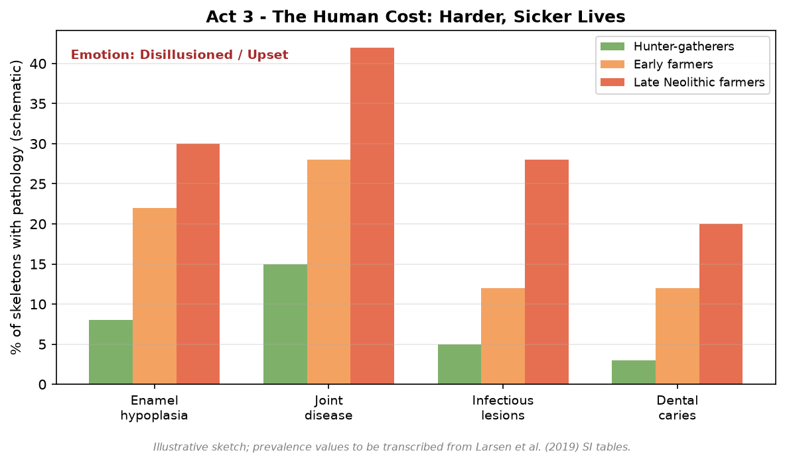
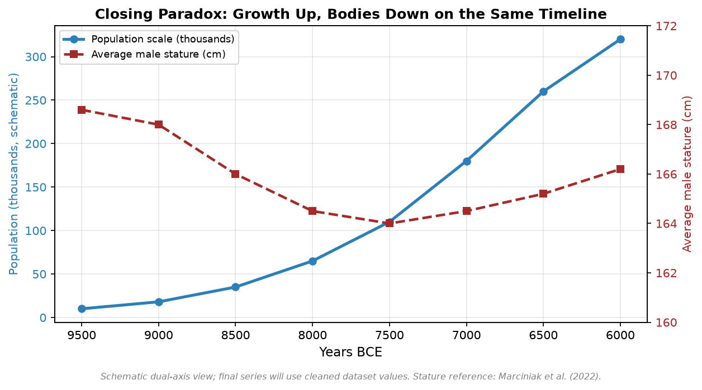

| [home page](https://cat-of-landlord.github.io/tswd-portfolio-templates/) | [ai critique](ai-critique) | [data viz examples](dataviz-examples) | [critique by design](critique-by-design) | [final project I](final-project-part-one) | [final project II](final-project-part-two) | [final project III](final-project-part-three) |

# Final Project Part II — Wireframes, Storyboards, and User Research

> **Working Shorthand draft:** [shared preview](https://preview.shorthand.com/h0DWXOv0qgrajHY5/responsive/desktop) · [editor view (login required)](https://app.shorthand.com/organisations/JSrgFWI7zn/stories/hnrtcMQi9c). The draft keeps being edited after this Part II submission; this page documents the wireframes, storyboard, and user research behind it.

*Telling Stories with Data, Fall 2026. This page documents the draft story, section-by-section storyboard, narrowed audience and personas, user research protocol and interview script, and the changes planned for Part III. Draft visualizations are early-stage renders; final versions will be rebuilt in Tableau.*

---

## 1. From Part I feedback to this draft

Part I received feedback from two reviewers. Each comment was mapped by impact on the story and ease of completion before the next deadline, and the high-impact, feasible items were carried into this draft.

| Part I feedback | How it is addressed in Part II |
|---|---|
| *"I wonder if the audience makes sense? Is there a way to further focus this?"* (reviewer CG) | The audience is narrowed from a general reader to a defined group: CMU/early-career grad students and analysts in their 20s–30s who work with data and encounter productivity-growth debates. Two personas are documented in Section 3. |
| *"It might be helpful to have some variety in them / adding a few more visualizations to help tell the story."* (reviewer CR) | The visualization roster expands from 3 to 8 views, adding diet breadth, oral health by period and sex, localized infection over time, workload/mobility markers, and a closing dual-axis paradox timeline (Section 2). |
| *"Interesting opportunities here for infographics to complement your visualizations … how a museum might help the audience connect."* (reviewer CG) | A museum-exhibit visual language is adopted in the moodboard (Section 5): earthy palette, short metric cards, and a "what the bones show" explainer panel that helps readers connect with 10,000-year-old material. |
| *"What the CTA could be here? Would you want your audience to do something in particular with this information?"* (reviewer CG) | An explicit closing call to action is defined in Section 2.4: readers identify one metric their own field uses to judge progress and consider who it leaves out. |
| *"ArcGIS Story Maps could be good if you want to show things via maps (although you should still be able to embed ArcGIS maps into Shorthand)."* (reviewer CG) | The Act 1 site map is retained as a planned panel; tool choice (simple mapped points vs. embedded ArcGIS layer) is left for Part III after user research. |

---

## 2. Wireframes and storyboard

### 2.1 Draft status and medium

This Part II draft is a working storyboard: major sections are in place, body copy is drafted, and critical views exist as early renders (draft links at the top of this page). Missing pieces (final Tableau builds, real map layer, polished annotations) are scheduled for Part III. The final medium is a Shorthand scrolling story built from its native long-form template, with Tableau Public visualizations embedded; a self-contained HTML fallback draft is kept alongside this page in case a section needs custom markup.

**Draft structure adjustments made while assembling the Shorthand version.** The working draft began from a long-form template that carried extra empty sections and placeholder stock imagery. Seven empty or stock-only sections with no planned content were removed rather than filled, which keeps the story within the account's section limit. The Act 3 workload-and-mobility view, originally planned as its own chart-backed section, now appears as a text sub-block under "The human cost"; its sketch remains in the HTML fallback and in the roster below. The standalone chart section was removed because Shorthand's built-in chart layer is a Business/Enterprise-plan feature on this account: its template sample data could not be cleared or edited in place, and leaving the template's sample marketing figures in a data story would have been misleading. Short chart-background sections were given a heading, a one-paragraph reading, and a source caption so the background renders with enough text; heading, subtitle, and body still share one editor block and will be split for finer typography in Part III.

**Known Part III visual carry-overs.** The hero, title, and closing CTA still use placeholder stock images; the Act 1 site map panel is not yet built; the schematic views are rebuilt in Tableau once cleaned source data is ready; mobile portrait alternates and per-chart captions are still pending.

### 2.2 Storyboard overview

```
[Hero] What did agriculture cost?
   → Act 1 · The promise of stability ........... optimistic
        site map + population growth line + scale cards
   → Act 2 · The hidden tradeoff ................ unsettled
        diet breadth + stature bars + caries by period/sex
   → Act 3 · The human cost ..................... disillusioned
        infection trajectory + trauma record + workload markers
   → Closing · What should we count? ............ reflective
        dual-axis paradox timeline + reflection CTA
```

### 2.3 Section-by-section walkthrough

#### Section 0 — Hero / title

- **Purpose:** set the question before any data appear, and signal that the story is about measurement, not nostalgia.
- **Copy (draft):**
  - Title: *What Did Agriculture Cost?*
  - Dek: *Ten thousand years ago, farming let humans settle down and grow in number. The bones of that period show what the growth cost the people living through it.*
- **Visual:** wide earth-toned hero image (open licensed archaeological landscape or site photograph), short subtitle, no chart.
- **Emotion:** curious, neutral.

#### Section 1 — Act 1: The promise of stability (Optimistic)

- **Narrative:** Before farming, groups lived with seasonal scarcity and no buffer against bad years. In the Fertile Crescent, the domestication of wheat and barley, then sheep and goat, brought stored surpluses, fixed settlements, higher fertility, and faster population growth. The section affirms the familiar "agriculture as progress" reading before the turn.
- **Site anchor:** the story follows the Near Eastern Neolithic, centered on Çatalhöyük in central Anatolia (modern Turkey), occupied roughly 7100–5950 cal BCE. The tell covers about 13 ha, rose nearly 21 m through stacked house levels, and held 470 documented burials; its Middle Period peak population is estimated at roughly 3,500–8,000 people. These numbers anchor the later comparison between collective scale and individual bodies.
- **Copy (draft):** *For most of human history, food was uncertain. A failed hunt or a dry season could mean hunger. In the Fertile Crescent, the domestication of grains and animals changed that: surplus could be stored, villages could be permanent, and more children survived. By every scale we usually measure, this looked like progress.*
- **Metric cards (draft):** ~13 ha settlement footprint · ~1,150 years of continuous occupation · 470 documented burials · peak estimate 3,500–8,000 residents.
- **Visual A — site map:** points marking excavated Near Eastern Neolithic sites, color intensity by estimated site size.
- **Visual B — population timeline:** rising line of estimated regional population, annotated with domestication milestones.



*Placeholder reconstruction; final population values will use Neotoma and site occupation estimates. Site facts: Larsen et al. (2019), PNAS; Çatalhöyük Research Project guidebook.*

#### Section 2 — Act 2: The hidden tradeoff (Unsettled)

- **Narrative:** Caloric reliability did not equal nutritional quality. Diets contracted from a broad mix of wild plants and game toward a narrow grain-heavy staple. Skeletons record the result: lower adult stature, enamel hypoplasias from childhood stress episodes, and sustained oral disease. Population climbs while bodies shrink.
- **Evidence layer 1 — diet breadth:** foragers drew on dozens of wild plants and animals; early farmers concentrated on a few domesticated staples and their livestock.
- **Evidence layer 2 — body size:** in comparative skeletal series, early farmers are shorter than the foragers who preceded them, even after controlling for genetic ancestry.
- **Evidence layer 3 — childhood stress:** linear enamel hypoplasias (growth defects in tooth crowns) mark episodes of nutritional or illness stress in childhood. At Çatalhöyük, such defects are essentially ubiquitous on permanent canines across all three occupation periods.
- **Evidence layer 4 — oral health:** caries stayed elevated across the community's 1,150 years. At Çatalhöyük, adult female caries prevalence ran 10.5% (Early), 12.9% (Middle), 10.4% (Late); adult males 9.7%, 10.0%, 11.0%. A global metastudy of 185 sites likewise finds higher average caries in agriculturalists than foragers, though with wide regional overlap.
- **Copy (draft):** *Reliable food was not the same as good food. Where foragers ate dozens of wild plants and animals, early farmers relied on a small number of staples. The skeletons tell the cost: adults grew shorter, childhood stress marks were common, and teeth showed the strain of a carbohydrate-heavy diet. The community was growing — but the people in it were not thriving.*
- **Visual C — diet breadth:** food-source categories compared between foragers and early farmers (wild plants, wild animals, domestic crops, domestic animals).
- **Visual D — stature by period and sex:** grouped bars, three period groups, males and females side by side.
- **Visual E — caries by period and sex:** grouped bars, Early/Middle/Late periods, females and males side by side, real Larsen (2019) values.







*Stature source: Marciniak et al. (2022), PNAS, Dataset S1 (n = 167, European comparative sample); Near Eastern samples will be added and comparative scope labeled clearly. Caries source: Larsen et al. (2019), PNAS, Çatalhöyük skeletal series.*

#### Section 3 — Act 3: The human cost (Disillusioned)

- **Narrative:** Costs deepen beyond nutrition. Farming demanded longer repetitive heavy labor, and bone cross-sections show workload and daily mobility rising through the Çatalhöyük sequence for adults and juveniles alike. Crowding, animal proximity, and accumulated waste promoted infection; as the community peaked in density, interpersonal conflict left its mark on skulls. The section does not claim every marker worsened in lockstep — the infection record actually falls as the Late Period community thinned — but the combined burden of labor, oral disease, crowding, and trauma is heavier than the forager baseline.
- **Evidence layer 1 — workload and mobility:** long-bone cross-sectional geometry shows increasing mechanical demands and daily travel distance from Early to Late Period, including among children.
- **Evidence layer 2 — localized infection:** subperiosteal reactions (bone surface reactions to localized bacterial infection) occur in 33% of Early, 26% of Middle, and 19% of Late skeletons; the decline tracks the Late Period drop in crowding rather than an overall improvement in living conditions.
- **Evidence layer 3 — interpersonal violence:** among 93 analyzed crania, 25 carry healed depressed fractures; 13% are injury recidivists with two to five wounds over their lives. Trauma frequency rises toward the denser Middle and Late Periods.
- **Evidence layer 4 — persistent oral disease:** caries remains elevated throughout, as shown in Act 2.
- **Copy (draft):** *Farming was also more work. Fields and herds demanded daily, repetitive labor, and crowded settlements brought parasites, infections, and more contact between neighbors. The bones show worn joints, spinal strain, healed head injuries, and teeth marked by a staple-heavy diet. A larger, denser society had become harder to live inside — and the people carrying those costs are the ones the aggregate numbers leave out.*
- **Visual F — infection trajectory:** three-period bar of subperiosteal reaction prevalence, real Larsen (2019) values.
- **Visual G — workload and mobility markers:** grouped bars for joint disease, spinal compression, limb-bone asymmetry, repetitive-stress markers.
- **Visual H — pathology burden:** grouped bars by pathology category, three population groups.







*Infection source: Larsen et al. (2019), PNAS. Workload and pathology sketches are illustrative; marker prevalences will be transcribed from Larsen SI tables and comparative meta-studies in Part III.*

#### Section 4 — Closing: What should we count? (Reflective)

- **Narrative:** The story does not indict farming. It asks which metrics a society is judged by: size, output, and density alone, or individual health, workload, and burden. Three questions carry the reader out of the section:
  1. **What does the headline count?** Population, stored surplus, and settlement size are real achievements; they do not measure how individuals fared inside the system.
  2. **Who carries the hidden cost?** The people whose bones record shorter stature, worn joints, infection, and trauma rarely appear in the success metrics of the transition that shaped their lives.
  3. **What would a fairer metric set look like?** Any measure of progress that counts aggregate growth but omits individual outcomes tells a partial story.
- **Modern parallel (deliberately restrained):** Readers today also see aggregate growth, efficiency, and technological output held up as evidence of progress. The story does not equate the Neolithic transition with any current transition, and it takes no position on a specific policy or company. It only invites the same comparison in the reader's own moment: who is counted in the headline number, and who carries the costs the headline does not show.
- **Copy (draft):** *This is not an argument against agriculture. It is a question about measurement. Judged by how many people it supported, farming was a triumph. Judged by how its people's bodies held up, the picture changes. Ten thousand years later, societies still grow in ways that please aggregate numbers while individual outcomes lag. Which metrics should we trust to tell us whether life is actually getting better?*
- **Visual I — closing paradox timeline:** dual-axis view, rising population scale against falling/rebounding stature on one shared timeline, act markers along the axis.



- **Call to action:** *Before you leave, think of one metric your own field or team uses to judge "progress" — and consider who that metric leaves out.* A footer links to the source datasets for readers who want to inspect the evidence themselves.

### 2.4 Visualization roster

| # | View | Chart type | Story role | Data source | Status |
|---|---|---|---|---|---|
| 1 | Population growth | Line chart, time axis | Act 1: collective scale grows | Neotoma, site occupation estimates | Schematic draft |
| 2 | Site map | Point map, color by site size | Act 1: settlement spread | Neotoma / Open Context site records | Wireframe only |
| 3 | Diet breadth | Grouped bars by food category | Act 2: diet narrows | Open Context faunal NISP; botanical remains | Schematic draft |
| 4 | Stature by period/sex | Grouped bars, sex comparison | Act 2: bodies shrink | Marciniak et al. (2022) Dataset S1 | Real published means; cleaned sample pending |
| 5 | Caries by period/sex | Grouped bars, sex comparison | Act 2: oral health stays compromised | Larsen et al. (2019) | Real published values |
| 6 | Infection over time | Three-period bars | Act 3: crowding and localized infection | Larsen et al. (2019) | Real published values |
| 7 | Workload markers | Grouped bars by marker type | Act 3: harder labor | Larsen et al. (2019); comparative studies | Schematic draft; in the current Shorthand draft this view is an Act 3 text sub-block, and the sketch is kept in the HTML fallback |
| 8 | Pathology burden | Grouped bars by condition | Act 3: combined disease burden | Larsen et al. (2019) SI tables | Schematic draft |
| 9 | Closing paradox | Dual-axis timeline | Resounding message | Combined cleaned datasets | Schematic draft |

Design conventions carried into every view: descriptive title that states the point, labeled axes with units, legends, source caption under each chart, and no 3D or decorative encoding.

### 2.5 Scope, evidence limits, and caveats

The story keeps its geographic focus on the Near East and Anatolia, with the Çatalhöyük sequence as the central case. Three limits are stated in the final piece so the evidence is not overclaimed:

- **Regional variation:** health trends after farming differ by region, crop, and local ecology; caries and stress markers are not universal markers of subsistence, and some forager groups show elevated rates from wild cariogenic plants.
- **The osteological paradox:** a skeleton preserves markers only if the person survived them; low marker prevalence can reflect high mortality rather than good health.
- **Comparative sample scope:** the stature chart currently uses a European comparative sample; Near Eastern samples will be added, and the comparative frame will be labeled explicitly on the view.

---

## 3. User research

### 3.1 Target audience

The story is not aimed at a general public. The primary audience is **CMU Heinz and related master's students, and early-career analysts in their 20s–30s**, who work with data or dashboards, follow technology and productivity debates, and have no archaeology or anthropology background. They read charts comfortably but approach historical claims with the same skepticism they apply to any data argument.

A secondary audience is readers who seek out history and anthropology in museum-style digital exhibits; the exhibit-inspired visual language in Section 5 serves this group without changing the primary target.

### 3.2 Recruitment approach

- **Who to recruit:** at least three interviewees matching the primary audience: graduate students or early-career workers, 20s–30s, mixed technical and policy backgrounds, no archaeology/anthropology training.
- **How:** classmates, study-group peers, and connections through campus groups; 15-minute semi-structured sessions, in person or video call, think-aloud over the draft storyboard.
- **Representation check:** the sample should mix readers who are comfortable with charts and readers who rely on the argument rather than the numbers; no two interviewees from the same narrow coursework group if possible.
- **Privacy:** interviewees are identified only by generic description (e.g., "Interview 1 — grad student, 20s, technical background"). No names, program details, or other identifying information are recorded.

### 3.3 Personas (optional reference)

**Persona A — MISM student, mid-20s, technical.** Works with dashboards and KPIs daily; comfortable reading charts; skeptical of hype and wants to see the numbers before accepting a claim. Reacts well to clear encodings and visible sources; loses trust when a chart's claim outruns its evidence. Needs the prehistorical data explained just enough to follow the comparison.

**Persona B — Policy-oriented grad student, late 20s.** Reads for argument and distribution of costs and benefits; less fluent in chart detail. Responds to who wins and who loses in a transition; needs the bottom line stated in plain language before the detail. The modern parallel in the closing matters more to this persona than the skeletal terminology.

### 3.4 Research goals and interview script

**Research goals**

1. **Comprehension:** Does the reader grasp the core paradox — collective growth alongside worsening individual health — after the first pass?
2. **Story logic:** Does the three-act turn land clearly, or does any step read as a logical leap?
3. **Visualization comprehension:** Can each chart be read on its own? Are titles, axes, legends, units, and sources clear?
4. **Relevance and bridge:** Does the Neolithic material feel relevant to this audience? Does the closing parallel to today's productivity transitions feel earned or forced?
5. **Call to action:** Is the takeaway and the closing CTA clear?
6. **Open improvements:** What is confusing, jargon-heavy, boring, or missing?

| Goal | Questions to ask |
|------|------------------|
| Comprehension | 1. After reading the opening, how would you describe what this story is about, in your own words? 2. What question does it seem to be asking you? |
| Story logic | 3. At what point did you feel the story shift from "farming looks like progress" to "something went wrong"? Was that turn clear? 4. Does the connection between population growth and worse health make sense? Where, if anywhere, did it feel like a leap? |
| Visualization comprehension | 5. Walking through each chart: what does it show you, and what stands out? 6. Are the labels, axes, legends, and units clear? Anything you had to guess at? 7. Which chart felt most convincing, and which least? Why? |
| Relevance and bridge | 8. Does a 10,000-year-old farming story feel relevant to you? Where did it connect, and where did it feel distant? 9. Does the parallel to today's productivity or technology transitions feel earned, or forced? 10. What would you want to know more about afterward? |
| Call to action | 11. After reading, is there anything you feel prompted to do or reconsider? If not, what feels missing? 12. Who do you think this story is for? |
| Open improvements | 13. What was confusing, boring, or missing? 14. Any wording or jargon you would change? |

**Session flow:** (1) one-minute context that this is a draft and the feedback is on the story, not the person; (2) think-aloud through the storyboard in order; (3) questions above, pausing at each section; (4) 2–3 minutes of free reaction at the end. Notes capture direct quotes where possible, with consistent observations and conflicting observations marked separately.

### 3.5 Interview findings

*To be completed after the interviews. Interviewees are described generically; no PII is recorded.*

| Questions | Interview 1 (generic description) | Interview 2 (generic description) | Interview 3 (generic description) |
|---|---|---|---|
| Q1–2: Core paradox understood in their own words? |  |  |  |
| Q3–4: Story turn and logic clear?  |  |  |  |
| Q5–7: Chart readability, labels, most/least convincing view? |  |  |  |
| Q8–10: Relevance; modern parallel earned or forced? |  |  |  |
| Q11–12: CTA clarity; intended audience? |  |  |  |
| Q13–14: Confusion, jargon, missing pieces? |  |  |  |

**Synthesis notes (consistent vs. conflicting feedback):**

- *Consistent observations across interviews:* to be filled in after sessions.
- *Conflicting or divergent observations:* to be filled in after sessions.
- *Direct quotes worth keeping:* to be filled in after sessions, with the question they answered noted.

---

## 4. Identified changes for Part III

Part II does not implement every suggested change; it records the planned Part III actions. The table below pairs each finding or observation with the design change it implies.

| Research synthesis / feedback | Anticipated change for Part III |
|---|---|
| Audience focus was questioned in Part I | Keep the narrowed audience and personas above; test in interviews whether the framing lands for the primary group; adjust the opening dek if readers outside this group are confused. |
| More chart variety requested in Part I | Maintain the nine-view roster; replace schematic renders with Tableau builds once cleaned data is ready; add the site map as its own panel. |
| Museum-style connection devices suggested | Apply the Section 5 moodboard consistently: earthy palette, short metric cards, then/now contrast; add one "what the bones show" explainer panel defining stature, hypoplasia, caries, and lesions for non-specialists. |
| CTA needed definition | Keep the metric-reflection CTA in the closing; verify in interviews that it reads as a reflection prompt rather than an instruction to act externally. |
| Findings from the three interviews (to be added) | Row added after sessions: observation → specific visualization, copy, or structure change planned. |

**Open Part III priorities (ordered by story impact and ease):**

1. Clean and join the Marciniak (2022) stature sample; rebuild the stature and closing paradox views in Tableau with real Near East/Europe labeled values and source captions.
2. Transcribe Larsen (2019) prevalence tables; rebuild the pathology and workload panels in Tableau; keep the caries and infection views as verified real-data views.
3. Resolve the site map: simple mapped points vs. embedded ArcGIS layer.
4. Apply consistent moodboard styling across all views and the Shorthand sections.
5. Revise copy and chart order based on interview synthesis.

---

## 5. Moodboard and personas (optional)

**Visual mood:** museum-exhibit warmth — archaeological report meets clean digital long-form. Earth, bone, and clay tones; restrained use of terracotta only for the cost-side data; generous whitespace; serif display headings over a sans-serif body.

| Role | Color | Use |
|---|---|---|
| Parchment / bone | `#F2EAD8` | Backgrounds, cards |
| Charcoal | `#2E2A26` | Body text, primary strokes |
| Olive | `#6E7F5A` | Forager / baseline group |
| Sand | `#D9B382` | Early farmer group, secondary fills |
| Terracotta | `#B5563C` | Late farmer / cost-side emphasis, accent only |

**Typography:** serif display (Georgia / Source Serif style) for section titles and chart headlines; system sans-serif for body, annotations, and captions.

**Reference directions:** museum digital exhibits that use artifact photography alongside short metric panels; Financial Times-style long-form visual storytelling; consistent color and messaging across every section, as in branded storytelling.

---

## References

- Larsen, C. S., et al. (2019). "Bioarchaeology of Neolithic Çatalhöyük reveals fundamental transitions in health, mobility, and lifestyle in early farmers." *PNAS* 116(25), 12615–12623. https://www.pnas.org/doi/10.1073/pnas.1904345116
- Marciniak, S., et al. (2022). "An integrative skeletal and paleogenomic analysis of stature variation suggests relatively reduced health for early European farmers." *PNAS*. https://www.pnas.org/doi/10.1073/pnas.2106743119
- Open Context. (2013). *Çatalhöyük Zooarchaeology*. https://opencontext.org/projects/1b426f7c-99ec-4322-4069-e8dbd927ccf1
- Rosenstock, E., et al. (2019). "Human stature in the Near East and Europe ca. 10,000–1000 BC." *Archaeological and Anthropological Sciences* 11(10), 5657–5690. https://doi.org/10.1007/s12520-019-00850-3
- "The Precarious State of Subsistence: Reevaluating Dental Pathological Lesions Associated with Agricultural and Hunter-Gatherer Lifeways" (metastudy, 185 archaeological sites). *Current Anthropology* 60(3), 2019. https://escholarship.org/content/qt29q8m09r/qt29q8m09r.pdf
- Çatalhöyük Research Project. *Neolithic Site Guidebook*. https://catalhoyuk.com/sites/default/files/Catalhoyuk-Guidebook-ENGLISH.pdf
- Neotoma Paleoecology Database. https://www.neotomadb.org
- Berinato, S. *Good Charts*, Chapter 7: Persuasion or manipulation? The blurred edge of truth. Harvard Business Review Press.

## AI acknowledgements

- **Process support:** An AI assistant helped structure the Part II storyboard, draft interview questions, and organize the feedback-to-change mapping. The audience definition, persona framing, story arc, and interpretation of Part I feedback were my own decisions.
- **Sketch generation:** The schematic charts were generated with Python/matplotlib; values labeled schematic are placeholders pending cleaned source data. Real-data views (stature means, caries by period/sex, infection prevalence) were checked against Marciniak et al. (2022) and Larsen et al. (2019).
- **Verification:** Source links and published statistics were checked against the referenced publications; final data cleaning, Tableau builds, interview findings, and Part III revisions remain my own work.
